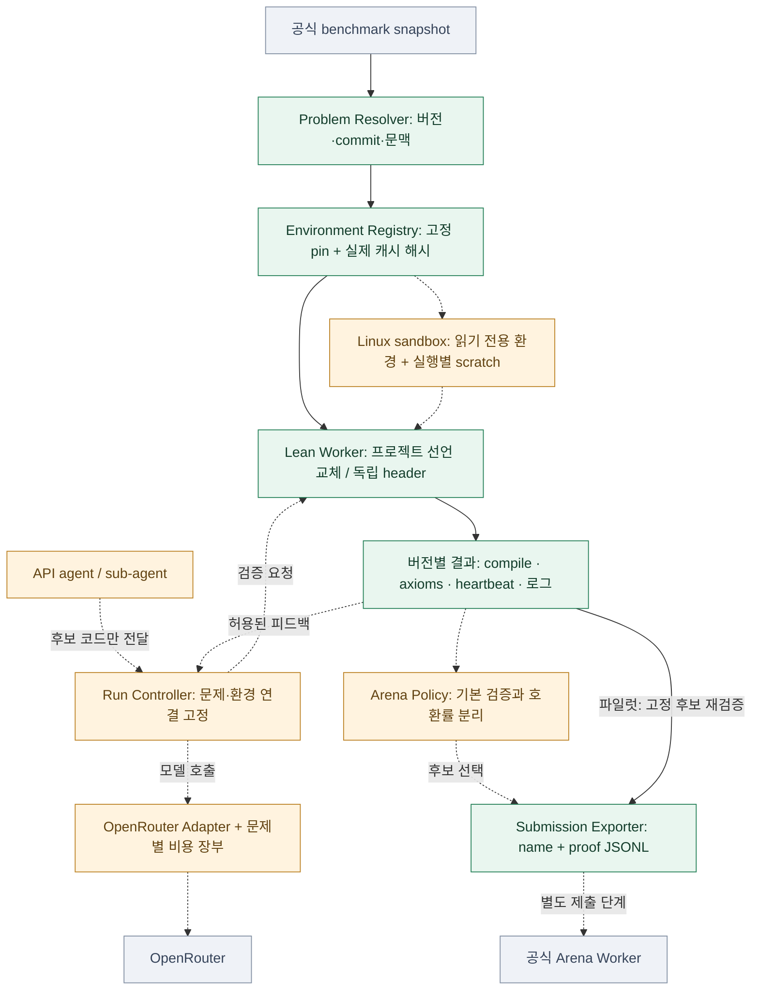

# [가안] 문제별 고정 환경의 검증과 구현 구조

> 논의용 설계 가안이다. 구현 채택이나 대회용 격리의 완성을 뜻하지 않는다.
> [HTML 문서와 구조도](environment-proposal.html)에서 검증 범위와 구현 계획을 함께 볼 수 있다.

문제별 Lean 버전, 의존성, 문맥을 runner가 소유하고 모든 후보를 그 환경에서 검증한다.
agent는 후보 코드를 제출하며 compiler 경로, 환경변수, 저장소 commit을 선택하지 않는다.
이 문서는 실제 warm-up 두 문제의 로컬 파일럿과 다음 구현의 경계를 설명한다.

## 검증 결과 — 2026-10-18

대표 두 문제의 공식 지정 환경 네 개에서 파일럿이 통과했다. 기존 후보를 재사용했으며 API 호출은 0회다.
macOS arm64에서 실행한 결과로, 공식 Linux worker와의 동등성이나 공식 점수를 확인한 것은 아니다.

| 문제 | Lean | 원본·후보·제출 재검증 | 로컬 heartbeat: 원본 → 후보 |
| --- | --- | --- | --- |
| Strata `CallElimCorrect.extractedOldExprInVars` | 4.26.0 | 모두 통과 | 2,698 → 447 |
| PutnamBench `putnam_1964_a4` | 4.25.0 | 모두 통과 | 141,070 → 3,661 |
| PutnamBench `putnam_1964_a4` | 4.26.0 | 모두 통과 | 115,677 → 2,931 |
| PutnamBench `putnam_1964_a4` | 4.27.0 | 모두 통과 | 111,470 → 2,876 |

총 24회 compiler 실행 중 정상 경로 20회가 성공하고 오류 후보 4회가 의도한 미정의 식별자 오류로 실패했다.
오류 후보의 실패가 timeout이나 실행 환경 오류 때문이 아님을 로그에서 확인했다.
원본과 후보의 대상 정리 공리는 허용 목록 안에 있었으며, 컴파일러·라이브러리 artifact와 저장소 pin은 실행 전후 동일했다.

- 잘못된 Lean 버전·저장소 commit은 실행 전에 거절됐다.
- 부모의 `PATH`, `LEAN_PATH`, `ELAN_TOOLCHAIN`을 잘못 설정해도 네 환경 모두 지정된 compiler와 의존성으로 재검증됐다.
- compiler sandbox의 파일 쓰기·네트워크 차단, source 도구의 상위 경로·절대 경로·외부 symlink 거절을 확인했다. 같은 파일 열기·접속 명령은 sandbox 밖에서 성공하고 안에서 실패했다.
- 최종 JSONL은 두 문제 각각 `name`, `proof`만 포함한다. 역직렬화한 proof의 hash가 검증한 후보와 같고, 재검증한 source도 후보의 기존 source와 같다.
- 24회 실행의 입력·로그 hash, 실행 스크립트 snapshot, 평가기 hash를 최종 대조했다. 기존 단위 테스트는 26개 통과, 선택적 Lean 테스트 4개 skip이었다.

공유 결과: [요약 JSON](environment-pilot-results.json). 전체 compiler 입력·로그·제출 JSONL은
실험 장비의 `runs/environment-pilot-20261018-r2/`에 보존하며 Git에는 포함하지 않는다.
요약에는 원본 report와 제출 JSONL의 SHA-256을 남겼다. 원본 report의 내용은 수정하지 않았다.
공식 서버에 업로드하지 않았다. heartbeat는 proof·환경별 1회 로컬 계측값이다.

## 구현 구조

초록색은 파일럿에서 실행한 기능, 주황색은 통합하거나 추가 구현할 기능, 회색은 외부 시스템이다.
실선은 파일럿에서 실행한 데이터 흐름, 점선은 제안하는 연결이다.
Environment Registry는 이번에 기존 캐시의 pin과 파일 해시를 검증했다. 깨끗한 이미지 빌드는 아직 포함하지 않는다.



편집 가능한 Mermaid 원본: [environment-architecture.mmd](environment-architecture.mmd).

## 실제 파일럿의 범위

실행 코드: [validate_environment_pilot.py](../scripts/validate_environment_pilot.py).
기존 `refactor_eval`의 선언 검사, 토큰 계산, heartbeat·공리 계측 wrapper를 재사용한다.
기존 `Session`의 두 지표 선택 정책을 변경하지 않으며, 새 모델이나 탐색 알고리즘의 성능을 시험하지 않는다.
기존에 저장된 후보를 입력으로 사용한다.

| 문제 | 검증 환경 | 원본 문맥 |
| --- | --- | --- |
| `CallElimCorrect.extractedOldExprInVars` | Strata, Lean 4.26.0 | 원본 파일 전체에서 해당 선언만 교체 |
| `putnam_1964_a4` | Mathlib, Lean 4.25.0·4.26.0·4.27.0 | 공식 header와 동일한 후보 선언 조합 |

각 환경에서 다음 경로를 실행한다.

1. 공식 `version_info`의 commit과 checkout HEAD, toolchain, 의존성 commit을 대조한다.
2. compiler의 `bin`·`lib`, 프로젝트와 의존성의 Lean 라이브러리 파일을 해시해 lock을 기록한다.
3. 원본과 후보를 각각 계측 없는 새 프로세스에서 컴파일하고, 별도 새 프로세스에서 heartbeat와 대상 공리를 확인한다.
4. JSON 직렬화·역직렬화한 후보가 같은 bytes인지 확인하고 재컴파일한다. 이때 부모의 `PATH`, `LEAN_PATH`, `ELAN_TOOLCHAIN`은 고의로 잘못 설정한다.
5. 존재하지 않는 식별자를 사용하는 오류 후보가 실패하는지 확인한다.
6. 실제 파일 쓰기와 열려 있는 loopback 포트로의 접속이 compiler sandbox에서 차단되는지 확인한다.
7. source 도구에서 상위 경로, 절대 경로, 외부로 향하는 심볼릭 링크를 거절한다.
8. 종료 후 artifact 해시와 checkout 상태를 다시 확인한다. 성공한 후보만 `name`, `proof` 두 필드의 JSONL로 내보낸다.

각 환경의 `environment.lock.json`, `artifact-hashes.json`, compiler 입력과 로그, 전체 `report.json`을 실행 디렉터리에 보존한다.
로그의 `valid`는 해당 로컬 검증 결과다. 공식 점수는 계산하지 않는다.

## 재실행

Python 3.10 이상, macOS의 `sandbox-exec`, 준비된 정확한 Lean toolchain과 라이브러리 캐시가 필요하다.
실행기는 패키지 설치나 네트워크 다운로드를 수행하지 않는다. 서로 다른 실행은 새로운 출력 디렉터리를 사용한다.
이 스크립트는 당시 로컬 fixture 구성을 사용하는 파일럿이며 빈 환경에서 바로 실행되는 설치기는 아니다.
`--learn-root` 아래에는 `Strata`, `.cache/mathlib-<commit>` 및
`examples/lean-refactor/problems/{02-strata,13-putnambench}/candidates/arena-all-sol-high-2026-10-09.lean`이 필요하다.
후보와 캐시는 이 가안 브랜치에 포함하지 않는다. 일반적인 입력 API는 후속 구현 범위다.

```sh
python3 scripts/validate_environment_pilot.py \
  --benchmark /path/to/benchmark_data_warmup.jsonl \
  --learn-root /path/to/LEArN \
  --output runs/environment-pilot-new
```

검토한 공식 snapshot은 `8fdaaaa25b993ae8d894e9bb756c3ae222b58507`이며 입력 JSONL의 SHA-256은
`6209680cf00cde0765b77b24834cd72c64dd585b2f7e3f2a58209980ab59a804`이다.
다른 benchmark를 받으면 실행을 거절한다. 대상 범위를 넓힐 때는 resolver와 검증 fixture를 명시적으로 갱신한다.

## 다음 구현의 모듈 경계

아래 파일명은 제안이다. 현재 구현된 것은 파일럿 스크립트와 기존 평가 모듈이다.
고정 단위는 `문제 → 공식 환경 목록 → 후보 hash`다. PutnamBench는 한 문제에 세 개의
`environment_id`를 연결하고 같은 후보를 세 환경 모두에서 검사한다. agent가 유리한 버전만 선택할 수 없게 한다.

| 제안 모듈 | 책임 | 기존 코드와 연결 |
| --- | --- | --- |
| `problem_bundle.py` | 공식 문제를 독립 header형과 프로젝트 교체형으로 정규화. 버전별 원본 일치 확인 | `load_config()` 앞단 |
| `environment.py` | toolchain·의존성·빌드 산출물의 lock, 재사용 가능한 환경 ID, 준비와 실행의 분리 | `LeanEvaluator.fingerprint()` 확장 |
| `agent_tools.py` | run에 연결된 `get_context`, `read_source`, `check`, `submit` 제공. 요청자가 실행 옵션을 바꾸지 못하게 함 | `Session.feedback()`·`checkpoint()` |
| `runtimes/container.py` | Linux 환경 이미지, 읽기 전용 compiler·dependencies, 실행별 scratch, 네트워크와 파일 접근 제한 | `execute()`의 backend |
| `policies/arena.py` | 기본 컴파일 인정, 버전별 호환률, 길이·heartbeat 감소율을 별도로 계산 | 현재 로컬 `assess()`와 분리 |
| `submission.py` | 선택된 후보 bytes를 JSONL로 직렬화하고 재검증. 문제·환경·후보 hash 연결 | `finalize()` 이후 |
| `adapters/openrouter.py` | 대회용 모델 호출, 자식 agent를 포함한 문제별 비용 합산과 호출 전 예산 확인 | `propose()` adapter |

먼저 `problem_bundle.py`와 `environment.py`를 만들고 두 문제 fixture로 검증한다.
그다음 `agent_tools.py`를 `Session`에 연결한다. Linux container backend에서 읽기 격리를 확인한 뒤
실제 agent를 연결한다. 대회 점수 정책은 공식 worker의 기본 버전 선택·계측 명령을 확인한 후 확정한다.

## Agent와 runner 사이의 계약

아래는 추가 구현할 인터페이스다. 파일럿은 이 인터페이스의 실행·문맥 조립 기능을 직접 호출해 확인했다.

```python
tools = runner.bind(run_id)  # runner가 problem과 환경 목록을 결정한다.
context = tools.get_context()
source = tools.read_source(source_id="mathlib", relative_path="Mathlib/...")
feedback = tools.check(candidate_code)
receipt = tools.submit(candidate_code)
```

agent 요청에는 compiler, command, cwd, toolchain, dependency revision 인자를 두지 않는다.
자식 agent에도 같은 문제·환경 연결을 제공하되 쓰기 가능한 scratch는 따로 만든다.
소스는 승인된 root에서만 읽고, 후보 파일과 결과·lock 파일의 쓰기 권한은 분리한다.
이 제한은 프롬프트가 아니라 runner의 요청 처리와 OS 권한으로 적용한다.
agent가 임의 shell이나 별도 파일 도구를 받으면 `read_source()`의 검사만으로 파일 접근을 고정할 수 없다.
환경 연결은 runner가 보관하고, agent가 보낸 `run_id`나 `environment_id`만 믿고 다른 환경을 열어 주지 않는다.

모든 검증 결과에는 `run_id`, `problem_digest`, `environment_id`, `candidate_sha256`,
버전별 compiler 결과를 연결한다. 같은 후보를 다른 버전에서 확인할 때는 `candidate_sha256`이 같아야 한다.
환경을 바꾸려면 새 run을 만든다. 환경 준비 실패는 proof 실패와 구분해 실행을 중단하며,
누락된 toolchain을 호환성 0점으로 기록하지 않는다.

`submit()`은 후보를 기록하는 로컬 동작이다. Arena 사이트로 실제 업로드하는 단계는 별도로 둔다.
모델이 제공한 score나 "컴파일 성공"이라는 설명은 검증 결과를 대체할 수 없다.

## 검증의 한계

- macOS compiler 프로세스는 파일 쓰기와 네트워크를 차단한다. 파일 **읽기**는 OS 수준에서 제한하지 않는다. source 도구의 경로 검사만 확인했으므로 악의적인 Lean 코드나 임의의 shell에 대한 완전한 sandbox로 사용할 수 없다.
- 기존 캐시의 실제 bytes와 실행 전후 일관성을 확인한다. 저장소 소스에서 캐시를 다시 빌드해 provenance를 검증한 것은 아니다. 다른 호스트 프로세스가 중간에 변경하고 복원하는 경우까지 방지하지 않는다.
- 프로젝트 파일은 새 작업 디렉터리에 원래 상대 모듈 경로를 유지한 채 배치한다. Strata의 `experimental.module=true`를 명시한다. 다른 프로젝트의 Lake 옵션·native plugin을 일반적으로 처리하는 기능은 아직 없다.
- proof·환경별 heartbeat 계측은 한 번이다. 수치는 로컬 계측값이며 통계적 성능 추정이나 공식 worker 점수와의 일치를 주장하지 않는다.
- Docker 서버는 실행 중이 아니어서 Linux 컨테이너를 검증하지 않았다. API 호출, 실제 sub-agent 실행, 비용 한도, 자동 후보 선택도 이 파일럿의 검증 대상에 포함되지 않는다.
- 초기 실행에서 시스템 Git의 Xcode 라이선스 오류가 발생해 사용 가능한 Git 실행 파일을 선택하도록 수정했다. 읽기 허용 목록을 적용한 초기 sandbox probe는 정상 실행되지 않았으며 최종 파일럿은 위의 쓰기·네트워크 제한만 사용한다.

## 공식 근거

- [공식 문제 데이터](https://huggingface.co/spaces/delta-lab-ai/lean-refactor-arena/blob/main/benchmark_data_warmup.jsonl)
- [문제와 버전별 commit의 의미](https://huggingface.co/spaces/delta-lab-ai/lean-refactor-arena/blob/main/benchmark.py)
- [규칙과 제출 형식](https://huggingface.co/spaces/delta-lab-ai/lean-refactor-arena/blob/main/app.py)
- [공개 채점 집계](https://huggingface.co/spaces/delta-lab-ai/lean-refactor-arena/blob/main/leaderboard.py)

현재 대회 규칙은 Track 1의 모든 모델 호출을 OpenRouter로 보내고 재시도·폐기 후보까지 문제별 비용에 포함하도록 요구한다.
대회의 cross-version 평가는 동일한 증명을 지정 버전에서 검사한다. 버전별로 proof를 다시 작성해서 결과를 합치지 않는다.
