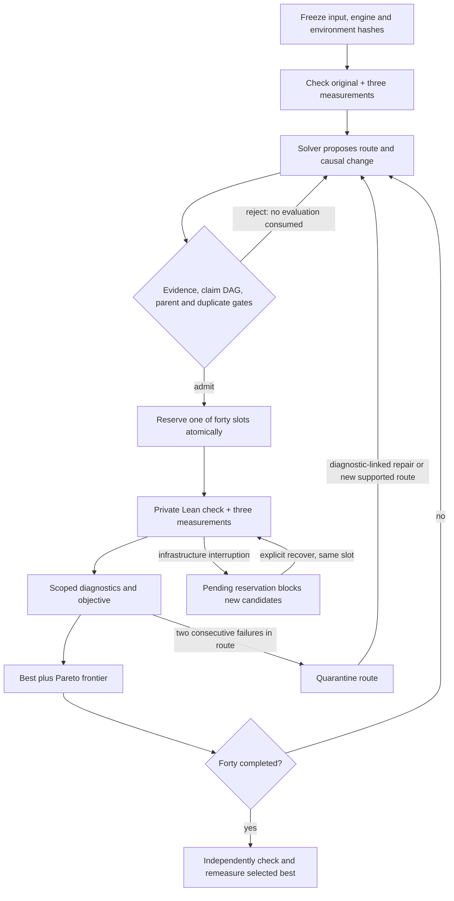

# 구조화 v6 local

[실험 목록](../README.md) · 정리 기준: 2026-11-02

## 목적과 방법

P01–P03 각40평가와 별도 golf로 구조 계획·계보·Pareto를 시험한다.

## 확인된 결과와 해석

P02는20토큰/370,630raw HB로 강하게 개선, P01/P03은 과거보다 O 악화. 평균 효과는 P02에 집중되며 prompt·장부 효과를 분리할 수 없다.

## 코드·Lean 보존 결정

후속 사후 대조와 함께 국소 기법의 근거로 보존한다.

## 보존 근거

아래는 당시 설계·실행 결과의 Markdown 본문이다. 당시의 진행 상태·경로·명령을 보존했으며, 현재 실행 지침이나 새 실행 요청이 아니다. 상충하는 중간 기록은 더 뒤의 완료 보고서와 본문 첫 요약을 우선한다. 결과 이해에 Lean·JSON·그림 열람은 필요하지 않다. 원시 로그를 다시 감사하거나 실행을 재현하려면 별도 원본·고정 환경이 필요하다.

| 원본 | 출처 | 원문 SHA256 |
| --- | --- | --- |
| `experiments/structured-reasoning-20261030/README.md` | `로컬 작업본` | `cf7f5debb02132ac4db5eb387161ed313400c9b94159978ad7047da0974bdc28` |
| `runs/structured-v6-local-20261030/report.md` | `로컬 작업본` | `d70c59fdb426d95a57f25b1db5850c301166854c74280a166d3eb46f4d72d3df` |

## 원문: `experiments/structured-reasoning-20261030/README.md`

### Structured reasoning v6: local experiment

This is a new local research harness; the frozen v5 API runner is unchanged.
It has no network/model API backend, automatic golf or automatic submission.
Fresh Codex solvers receive the same common instructions, original declaration,
provided API context, and their own results only. No per-problem strategy or
previous optimized candidate is placed in a solver packet.



Each admitted route has an immutable id, hypothesis, verbatim evidence, a
topologically ordered 2–8 node claim graph ending at `goal`, bridge and falsifier.
These are auditable solver hypotheses. Matching a quotation does not establish
its semantic relevance, and checking a complete Lean proof does not independently
verify every node in the proposed graph. Claims are not trusted as proven facts.

New routes use `explore`; valid descendants use `refine`; invalid descendants use
`repair` with exact parent diagnostic ids and a quotation from that feedback.
Two consecutive failures quarantine a route until an evidence-linked repair or
a new hypothesis is proposed. Six evaluations without best improvement produces
a route-reconsideration hint, not a forced restart or extra budget.

The controller rejects exact/comment-only repeats. It preserves Lean layout and
string contents; this is not semantic or alpha-equivalence deduplication. Each
admitted candidate consumes a slot even if Lean rejects it. Draft/preflight
rejections are separately logged and do not inflate the forty evaluation count.
The cap concerns completed candidate evaluations, not all compiler invocations:
baseline, each valid proof's three measurements and final verification are extra
compiler work. There is no claim this structured format fits forty paid API
requests inside $1.50; no paid requests are made in this local study.

State writes use atomic replacement under a per-problem lock. A chained event
ledger reconciles reserved plans, proof hashes, measured results and final
verification. Evaluated sources and fixed input/controller/evaluator/compiler
files are checked before further actions. An interrupted evaluation remains
reserved; `recover` explicitly resumes that slot with a fresh private evidence
directory. A failed independent final verification never creates a final result.

The best objective is `T/T0 + H/H0`. Historical original normalizers are fixed for
comparison, while each original is freshly checked and measured. A Pareto
frontier retains useful token/heartbeat tradeoffs. Fresh final measurements are
reported separately from selection measurements; no arbitrary noise threshold
is treated as a statistical confidence interval.

Only candidate-relative error lines and bounded diagnostic messages are public.
Full generated Lean files and logs remain in `runs/structured-v6-private-20261030`.
This is workflow isolation using solver instructions, not a security sandbox.
Compiler/library sources, other experiments and reference submissions are not
allowed solver material. Hashes establish byte consistency, not hostile-tamper
security or a complete fingerprint of all transitive installed dependencies.

#### Run

From the repository, apply the shared environment setup in every shell session:

```sh
source /Users/jwkweon/00_work/00_project/env/use.sh 05_pseudolab/LeanAgent-LeanRefactorArena
```

Use the existing central interpreter at
`/Users/jwkweon/00_work/00_project/env/05_pseudolab/LeanAgent-LeanRefactorArena/.venv/bin/python`. The setup script does not activate this interpreter.

```sh
LEAN_STUDY_PYTHON=/Users/jwkweon/00_work/00_project/env/05_pseudolab/LeanAgent-LeanRefactorArena/.venv/bin/python
```

```sh
"$LEAN_STUDY_PYTHON" -B experiments/structured-reasoning-20261030/controller.py prepare --problem-dir runs/NEW_RUN/P01
"$LEAN_STUDY_PYTHON" -B experiments/structured-reasoning-20261030/controller.py evaluate --problem-dir runs/NEW_RUN/P01 --candidate runs/NEW_RUN/P01/draft.lean --plan runs/NEW_RUN/P01/plan.json
"$LEAN_STUDY_PYTHON" -B experiments/structured-reasoning-20261030/controller.py status --problem-dir runs/NEW_RUN/P01
"$LEAN_STUDY_PYTHON" -B experiments/structured-reasoning-20261030/controller.py recover --problem-dir runs/NEW_RUN/P01
"$LEAN_STUDY_PYTHON" -B experiments/structured-reasoning-20261030/controller.py finalize --problem-dir runs/NEW_RUN/P01
"$LEAN_STUDY_PYTHON" -B -m unittest discover -s experiments/structured-reasoning-20261030 -p 'test_*.py' -v
```

For the prepared study, read-only progress and independent evidence auditing:

```sh
"$LEAN_STUDY_PYTHON" -B experiments/structured-reasoning-20261030/progress.py
"$LEAN_STUDY_PYTHON" -B experiments/structured-reasoning-20261030/audit.py --require-complete --write
```

After forty evaluations and final verification, `postprocess.py --problem P01`
runs the same frozen golf implementation as the prior study, separately from the
search budget. It screens strictly shorter deterministic variants, then performs
fresh three-sample seed/candidate verification. A candidate is adopted only if
its fresh objective is lower; otherwise the verified seed is kept. The existing
`best.lean` is preserved; `golf-best.lean` and `golf-summary.json` are separate.
Generated context, logs and screen caches stay private. An interrupted golf job
can be explicitly resumed with `--resume`: completed screens are reused and new
full verification receives a fresh evidence directory. The 0.3 token-unit screen
margin is an algorithmic selection parameter, not an empirical noise estimate.
After all three postprocessing jobs finish, `report.py` writes the final study
report and independently audited search/postprocess comparisons.

The frozen golf module qualifies `Name.toString` as `Lean.Name.toString` in the
measurement wrapper when imported. Both golf seed and candidate use that same
variant; search uses the original frozen evaluator wrapper. The designer audit
allows this exact qualification only for golf measurements from the allowlisted
source hash. It checks the rest of the generated template and candidate exactly.
This phase difference was found during independent review; an audit regression
test covers it. Frozen controller, inputs, golf driver and result files were not
changed to repair the audit expectation.

The example plan schema and research strategy are in `common-instructions.txt`.
Preparation currently supports the matched P01–P03 inputs only. The frozen
environments here are Lean v4.26.0. P03's other designated versions have not been
established by this study. No result is an official Arena score.

#### Study interpretation

The treatment combines a new shared prompt with a structured controller. Three
fresh solver contexts each run forty evaluations from original. The historical
v5-common forty-candidate local runs are a descriptive comparison, not a fresh
randomized control. One run per problem cannot establish generalization or
attribute any score change specifically to the ledger, prompt or solver
variation. Compare pre-golf search results with pre-golf results; keep subsequent
golf results separate. Hardening tests and integrity audits establish controller
behavior independently of whether this treatment improves proof quality.

## 원문: `runs/structured-v6-local-20261030/report.md`

### Structured reasoning v6 experiment

Fresh local Codex solvers, identical common instructions, no problem-specific hints. P01–P03 each completed forty candidate evaluations, independent final verification, then the same separate deterministic golf algorithm. Additional paid model API calls: zero.

#### Search results before golf

| Problem | Valid / invalid | Routes | Previous common O @40 | Structured O @40 | Cost change |
| --- | ---: | ---: | ---: | ---: | ---: |
| P01 | 32 / 8 | 6 | 0.349591 | 0.364751 | +4.34% |
| P02 | 30 / 10 | 9 | 0.381314 | 0.239242 | -37.26% |
| P03 | 33 / 7 | 6 | 0.377507 | 0.445344 | +17.97% |

Mean normalized objective: 0.369471 → 0.349779. Negative cost change is better.

#### After separate golf

| Problem | Previous golf T / H / O | Structured golf T / H / O | Cost change | New golf variants |
| --- | ---: | ---: | ---: | ---: |
| P01 | 24 / 1,241,990 / 0.316754 | 36 / 1,268,892 / 0.360293 | +13.75% | 101 |
| P02 | 42 / 517,777 / 0.381314 | 20 / 370,630 / 0.227615 | -40.31% | 124 |
| P03 | 75 / 199,415 / 0.377507 | 86 / 180,765 / 0.422622 | +11.95% | 364 |

Mean post-golf objective: 0.358525 → 0.336843.

#### Best objective by evaluation count

| Evaluations | Historical common mean O | Structured mean O |
| ---: | ---: | ---: |
| 6 | 0.870857 | 0.960941 |
| 10 | 0.636207 | 0.486753 |
| 20 | 0.422360 | 0.394490 |
| 30 | 0.391265 | 0.368020 |
| 40 | 0.369471 | 0.349779 |

#### Controller and integrity evidence

Controller/audit safety tests: 14 passed, no model API or Lean processes in the tests. Each real candidate was separately Lean-evaluated. Evidence audit checks frozen inputs and runtime files, hash-chained plans/results, exact trial counts, token counts, raw three-sample heartbeat medians, allowed axioms, unchanged templates, global best selection, final verification and candidate-relative diagnostic boundaries.

| Problem | Verified source/log hashes | Recorded compiler processes | Measurement samples | Preflight rejects |
| --- | ---: | ---: | ---: | ---: |
| P01 | 304 | 152 | 108 | 0 |
| P02 | 292 | 146 | 102 | 0 |
| P03 | 310 | 155 | 111 | 0 |

Compiler counts include baseline, candidate and full final/golf verifications; single-sample golf screening processes are counted separately as variants. Forty evaluations means forty candidate evaluator calls, not forty compiler processes or forty mathematically different routes.

The frozen historical golf module qualifies `Name.toString` as `Lean.Name.toString` inside the measurement wrapper at import. Both fresh golf seed and candidate measurements use that same wrapper. Search evidence uses the original wrapper. The audit checks the allowlisted golf-source hash and reproduces only this exact qualification inside the wrapper; it never rewrites the candidate/context or permits other source differences. An independent reviewer found the phase mismatch in the initial audit expectation; the designer audit and a regression test were corrected without changing frozen experiment files or rerunning search.

#### Interpretation

The historical comparator is descriptive, not a fresh randomized control. The new prompt and controller changed together, with one fresh solver per problem. Cost differences cannot be attributed specifically to the graph, prompt or solver variation. The historical P01 control also had documented generated-source/log exposure in attempt 02 and one following-declaration diagnostic line after attempt 40; its solver reported not reading full generated sources. That control was not fully source-isolated. Route graphs and quoted evidence are hypotheses and provenance checks; intermediate claims are not separately verified by Lean. Only the completed declaration is checked.

Only frozen Lean v4.26.0 was verified. Additional designated P03 versions remain unverified. No official Arena score, fifteen-problem generalization, paid API budget equivalence, OS-level solver isolation, main merge or automatic submission is claimed. The existing frozen v5 API runner and old experiment files are unchanged.

#### Solver route notes

##### P01

P01 isolated structured-reasoning solver notes

Completed evaluations: 40 actual candidates, 32 valid, 8 invalid. Finalized independently with no pending evaluation.
Selected: attempt-35; T=39, H=1242368, O=0.364750547102.
Independent verification: valid=True; T=39, H=1242355, O=0.364748034200.
All forty candidates were evaluated through the frozen controller, including Lean failures. No source golf or postprocessing was performed.

Route lessons:
R1 (4 valid / 3 invalid): Dot List.Subset needed its own definition unfolded; subset_def did not expose these goals. Structural expression induction required explicit application-match splitting. Goal-only substitution unfolding helped, but structural induction remained slower than function induction.
R2 (2 valid / 0 invalid): Function induction aligned the proof with substOld computation and removed explicit application splitting. Restricting simplification to getVars and membership materially reduced cost.
R3 (15 valid / 0 invalid): Fixing the observed variable before induction avoided quantified membership transport. Normalizing the entire pointwise target once before induction, using direct singleton membership, and simplifying only generated goals produced the best proof. Its recursive hypotheses already had the required disjunctive form. Deferring membership normalization to grind was much slower. Exception-first orientation and extra implication simplification did not help. Goal-only standard simp yielded the useful shorter frontier attempt-40 (T=32, H=1473866, O=0.387134925621), while the restricted normalizer gave the lower objective.
R4 (8 valid / 5 invalid): Excluding h1 allowed strict original-membership preservation and reduced heartbeat cost, but the case split and bridge added source. Implication-shaped motives supported explicit Or.imp construction. Generic backward search was expensive; greedy apply_rules introduced unwanted function equalities, and the final two failed refinements left this route quarantined. A hygienic case-tag failure was repaired by splitting computation goals without named tags.
R5 (2 valid / 0 invalid): The arbitrary-replacement bound getVars(substOld var s e) subset getVars(e)++getVars(s) validated. Applying the successful early normalization and goal-only simplification reduced its heartbeat cost, but abstraction source outweighed the benefit.
R6 (1 valid / 0 invalid): A constructive shared append-transport helper validated but cost too much source and normalization compared with the pointwise function-induction proof.

Operational interruption: The parent reported a model-capacity interruption and resumed this solver while attempt-31 was running. The existing shell process completed normally. Explicit controller status then confirmed 31 completed, no inflight slot, and intact state; no recovery, replacement candidate, new run, or paid API trial was needed.

Isolation deviations: none. Research used only this problem input, original proof, own files, and public controller feedback. The common project AGENTS.md, account check, environment activation, and controller implementation were used solely for required operational purposes. No other problem/run/solution/private evidence/environment JSON/Lean library source was read. No web, model API, or delegation was used.
Verification limitation: These are local measurements in the frozen Lean 4.26.0 environment. No official score, leaderboard submission, or broader-version claim is made.


##### P02

P02 isolated solver notes
Allowed inputs: solver-input.json, original.lean, common operational instructions and controller.py.
Account check completed with the required environment sourced.
R1: Inducting on NormalizedOldExpr avoids repeated inversion. Feedback revealed custom List.Subset does not simplify reflexivity automatically and ite append association is left-associated.
Isolation deviations: none.
Measurements are local only.
R2: Sharing a custom append monotonicity lemma validated, but increased raw heartbeats. Direct membership proof of the helper did not fix the regression.
R3: Sublist is the useful compositional internal property. Sublist.append follows extraction order directly and Sublist.subset bridges to the original theorem. Removing getter normalization reduced cost.
R4: The panic list branch is definitionally empty in this environment. Clearing the retained normalization premise before expression induction establishes an unconditional stronger sublist theorem. An anonymous intro alone still lets induction generalize the premise.
R5: Function induction follows nested extraction matches. Leaf relations must be closed before broad simplification; apply_rules created spurious witnesses. Restricted solve_by_elim with Sublist.append is effective. Removing simp_all reduced H from 2772697 to 497325.
R6: Pointwise membership is valid but verbose. Function-aligned pointwise simplification leaves propositional disjunction transport. Using nomatch under try emitted persistent diagnostics on nonempty goals, so guarded definitional change is required.
R7: A local recursive sublist certificate validated, but was more expensive. Overlapping term-level app patterns do not provide the negative matcher information needed to reduce extractOldExprVars. Restoring explicit matcher splitting repaired the type mismatch. Primitive getter codomains did not improve this route.
R8: Staging the unconditional certificate before the implication is valid, but costs more than introducing and clearing the irrelevant premise.
R9: A single monomorphic append interface measurably reduces inference cost. Sharing every leaf interface is counterproductive. Removing duplicate registration of the local append theorem improves both tokens and heartbeats. Specializing only the empty-list leaf slightly reduces H but does not justify its extra source tokens.
Operational deviation: the initial read-only cat of the required root AGENTS.md preceded env/use.sh; all subsequent project and evaluator shell commands sourced the required environment. No isolation deviation occurred: no other problem, run, solution, fixture, private evidence, environment.json, Lean installation/library source, web source, model API, or delegated solver was consulted.
Final attribution within R9: specializing the reflexive interface accounts for most of the full-sharing regression (attempt-39 H=442255, versus attempt-36 H=365547). Empty-only sharing lowers H slightly to 363241, but adds four tokens. The best supported tradeoff therefore shares append only and lets the synthesis engine discover it from local context.
Completion: exactly 40 completed candidate evaluations, with 30 valid and 10 invalid. No recovery was required. No additional candidate evaluation followed the fortieth.
Selected: attempt-36, T=23, H=365547, O=0.239242463982928. Independent final-verification-1 passed with the same T/H/O, no diagnostics, Lean v4.26.0. Finalized successfully. Measurements are local to the frozen environment; no official score or submission is claimed.
The final backward-synthesis comparison (attempt-40) was valid but slightly more expensive at H=366415, confirming the selected apply_rules implementation.
Isolation deviations: none. The operational environment-sourcing detail is documented above.


##### P03

P03 solver notes — structured v6 local experiment

Protocol: Exactly 40 completed candidate evaluations. No preflight rejects were counted. Every candidate was submitted through the frozen controller with its own explore/refine/repair plan. Evaluated snapshots and controller/input/state files were never edited. No golf postprocessing was performed.

Selected proof: attempt-25.lean. T = 92; H = 161779; O = 0.44534400465271495 under fixed normalizers T0 = 224 and H0 = 4671681. Candidate totals: 33 valid, 7 invalid. Final independent controller verification was requested after evaluation 40; its result is appended below.

Route lessons:
- Batch commutation replaced the original single-update induction immediately. Completed update keys are defined and initialization keys undefined, so the key lists are disjoint; updatedStatesComm then identifies the completed stores.
- Sharing initial-store definedness and backwards-propagated undefinedness improved the representation. The same definedness fact supports disjointness and the final updatedStatesUpdate construction. Direct initialization in the existential conjunction is cheaper than separately packaging its relation.
- Staging the final update construction produced the selected small heartbeat improvement. Separating the completed-store equality, early store substitution, selective change, constrained simp, dsimp, and separate initialization obligation were valid but costlier.
- Some-value preservation through InitStates is valid, but requires Option case analysis and more proof source than the functional updatedStatesDefMonotone interface.
- Single-update induction can reuse canonical tail initialization and share singleton definedness. An update-only induction also works. Both remain substantially longer than commuting completed batches.
- Compact disjointness automation trades source tokens for heartbeat cost. Unfolding domain predicates and introducing membership assumptions reduced search cost, but the best measured objective remained the manual disjointness proof.
- Full canonical-interface automation initially saturated global list zip/map lemmas. Restricting the theorem set avoided saturation but required explicit canonical store equalities, lengths, and finally the exact post-initialization update relation. This completed route is valid but very expensive.

Failure classification:
- attempt-11: restricted grind obtained the contradictory store facts but lacked Option.isSome computation; adding that definition repaired it.
- attempt-13: simp_all left universal disjointness binders; introducing members and specializing definedness repaired it.
- attempt-19: List.Disjoint remained opaque to grind; introducing membership binders repaired it.
- attempt-29: global List.zip_map instances saturated the E-matching and split thresholds.
- attempt-30: restricted search lacked canonical ground store equalities and lengths.
- attempt-31: search reached batch commutation facts but did not construct the precise canonical update relation. Explicitly seeding that relation completed the route at attempt-32.
- attempt-40: restricting simp to the store equality and Option.isSome reduced the premise only to false = true, while the goal was False. The ambient Boolean constructor-inequality simplification used by the selected proof is necessary for that implementation. No 41st repair was run.

Isolation deviations: none. Problem research used only this problem packet, original proof, own candidates/plans, and public feedback in P03. The common instructions and controller were read solely for operational usage. No other run/problem, private evidence, environment.json, Lean/library source, web/model API, or delegated solver was accessed.

Environment/procedure note: The initial read-only command that opened the root AGENTS.md preceded sourcing the project environment. Every subsequent shell session sourced the specified environment, and the repository account check was invoked before research/evaluation. No account settings were changed.

Verification limitation: The frozen local controller verifies Lean v4.26.0 only. The additional designated v4.27.0 and v4.29.1 environments were not verified. Measurements are local, with no official score or submission implied.

Final independent verification: passed. Evidence label: final-verification-1. Verified versions: v4.26.0. Rechecked T/H/O = 92/161779/0.44534400465271495.
Final completed count: 40; valid: 33; invalid: 7. No evaluation remains in flight.
