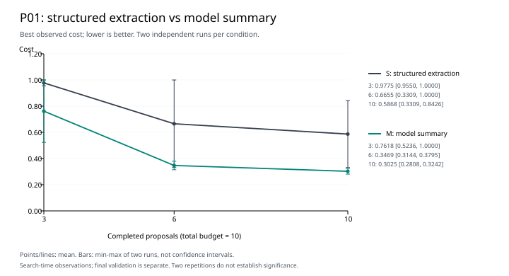
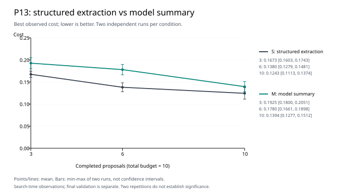

# 구조화 추출 vs 의미 보존 요약 결과

동일한 naive A 프롬프트·첫 오류 추출기·1,600자 상한에서 S(기존 structured_v1)와 M(독립 모델 요약)을 비교했다. M에는 메시지 요약과 goal·context의 원문 선택을 요청하고 수리 전략 생성을 금지했다. 문제별·조건별 두 독립 solver, 실행당 10후보, 총 8실행·80후보다.

주 관측값은 3회차에 원본보다 낮은 비용을 찾은 실행 수다. 로컬 실험 비용은 `0.5 × (tokens/원본tokens + rawHB/원본rawHB)`이며 낮을수록 좋다. 3·6회는 처음부터 고지된 10회 예산 내 중간 관측이다.

| 문제 | 조건 | 3회차 개선 | 초반 유효 평균/3 | 3회 비용 | 6회 비용 | 10회 비용 | 최종 검증 |
|---|---|---:|---:|---:|---:|---:|---:|
| P01 | S | 1/2 | 1.00 | 0.977516 [0.955033, 1.000000] | 0.665453 [0.330907, 1.000000] | 0.586751 [0.330907, 0.842595] | 2/2 |
| P01 | M | 1/2 | 1.50 | 0.761812 [0.523623, 1.000000] | 0.346941 [0.314401, 0.379480] | 0.302502 [0.280821, 0.324182] | 2/2 |
| P13 | S | 2/2 | 2.50 | 0.167318 [0.160344, 0.174292] | 0.138004 [0.127862, 0.148147] | 0.124305 [0.111257, 0.137353] | 2/2 |
| P13 | M | 2/2 | 1.50 | 0.192549 [0.180034, 0.205064] | 0.177963 [0.166146, 0.189780] | 0.139428 [0.127681, 0.151176] | 2/2 |

비용 셀은 평균 [두 실행의 최솟값, 최댓값]이다. 최종 검증은 탐색 중 비용과 구분한다.

P01의 주 관측값(3회차 개선)은 S 1/2, M 1/2다. 10회차 평균 비용의 M 대 S 상대 차이는 -48.44%다. 이는 두 실행씩의 관측 차이이며 인과 효과 추정치가 아니다.

P13의 주 관측값(3회차 개선)은 S 2/2, M 2/2다. 10회차 평균 비용의 M 대 S 상대 차이는 +12.17%다. 이는 두 실행씩의 관측 차이이며 인과 효과 추정치가 아니다.

| 실행 | 첫 유효 | 첫 개선 | 3회 전 오류 노출 | 요약 jobs | fallback | 최종 검증 |
|---|---:|---:|---:|---:|---:|---|
| P01-S-r1 | 4 | 7 | 2 | 0 | 0 | 통과 |
| P13-M-r1 | 2 | 2 | 1 | 2 | 0 | 통과 |
| P13-S-r1 | 1 | 1 | 0 | 0 | 0 | 통과 |
| P01-M-r1 | 3 | 4 | 2 | 3 | 0 | 통과 |
| P01-M-r2 | 2 | 3 | 1 | 1 | 0 | 통과 |
| P13-S-r2 | 2 | 2 | 1 | 0 | 0 | 통과 |
| P13-M-r2 | 2 | 2 | 1 | 2 | 0 | 통과 |
| P01-S-r2 | 2 | 3 | 1 | 0 | 0 | 통과 |

요약 요청 8건, 관측 가능한 독립 요약 job 8개, fallback 0건이다. 요약 원문 입출력·응답 해시·대기시간·목표/가정 보존 길이는 results.json에 보존했다. 정확한 모델 ID·내부 호출 수·요금은 unknown이다.

초기 요청 동일성·80후보 기록/replay·최종 상태·전체 공유 런타임 전후 SHA256·요약 스키마/원문 선택 검사를 통과했다. 의미 보존과 전략 비포함은 기계 검사만으로 완전히 입증할 수 없다. 실제 오류 노출과 fallback을 함께 해석해야 한다.

조건당 두 번과 개발에 사용한 두 문제의 탐색 결과이며 통계적 우위나 일반화를 입증하지 않는다. 오류 이후 후보 유효성은 서로 다른 탐색 경로의 관측이다. 기록 replay는 모델 재생성이 아니다. 실행 안의 solver 대화는 유지되므로 매 회차 API 문맥이 완전히 통제된 실험은 아니다. 라이브러리는 정책상 공유 읽기 전용이며 OS 격리는 없다.

[전체 결과](results.json) · [사전 설계](design.frozen.json) · [전후 런타임 검사](runtime-checks.json) · [실행 프로토콜](execution-protocol.json)

원문 실행: `/Users/zzu0203/projects/01_가짜연구소/.worktrees/arena-feedback-summary-20261025/runs/feedback-summary-20261025`

이번 실행의 Lean 컴파일 호출: 후보 검증 260회, 최종 검증 32회, 원본·imports 사전 검증 10회다. `--version`/`--print-prefix` 조회와 재사용한 과거 baseline의 컴파일은 제외했다. 컴파일 횟수·증명 후보 수·요약 job 수·관측 불가능한 내부 모델 호출 수는 서로 다르다.

동일 오류를 S로 포맷한 출력과 실제 전달 내용이 달랐던 것은 2/8건이고, 더 짧게 전달된 것은 1/8건이다. 이는 같은 저장 로그를 다시 포맷한 조작 확인이며 추가 solver·Lean 실험이 아니다.

추출 원문 대비 오류 설명 문장을 바꾼 경우 0건, 동일 오류의 S 출력 대비 목표 선택이 달랐던 경우 1건, 가정 선택이 달랐던 경우 2건이다. 이 범주는 중복될 수 있으며, 모델 호출 자체와 실제 문장 요약·정보 선택의 발생을 구분한다.

사후 입력·출력 검토에서 의미 보존 우려 1건, 추가 수리 전략 관측 0건을 기록했다. 이 검토는 형식 검사와 별개이며 solver 피드백을 수정하지 않았다. [사례별 품질 검토](semantic-review.json)에서 근거를 확인할 수 있다.

원문 컴파일러의 제안을 그대로 남긴 경우는 1건이며, 엄격한 제안 비포함 조건에 대한 우려는 1건이다. 모델이 새로 추가한 수리 전략과 원문 제안의 잔존을 각각 기록했다.

P01 M 실행별 실제 변경 피드백 노출(3회차 이전/전체): P01-M-r1 1/1, P01-M-r2 1/1. 오류 노출이 있어도 S와 동일한 내용이면 변경된 정보에 대한 노출로 세지 않았다.

P13 M 실행별 실제 변경 피드백 노출(3회차 이전/전체): P13-M-r1 0/0, P13-M-r2 0/0. 오류 노출이 있어도 S와 동일한 내용이면 변경된 정보에 대한 노출로 세지 않았다.

P13에서는 M이 solver에게 전달한 오류 내용이 모두 같은 오류의 S 출력과 같았다. 따라서 조건 간 성능 차이로 요약 내용 변경의 효과를 식별할 수 없다.

