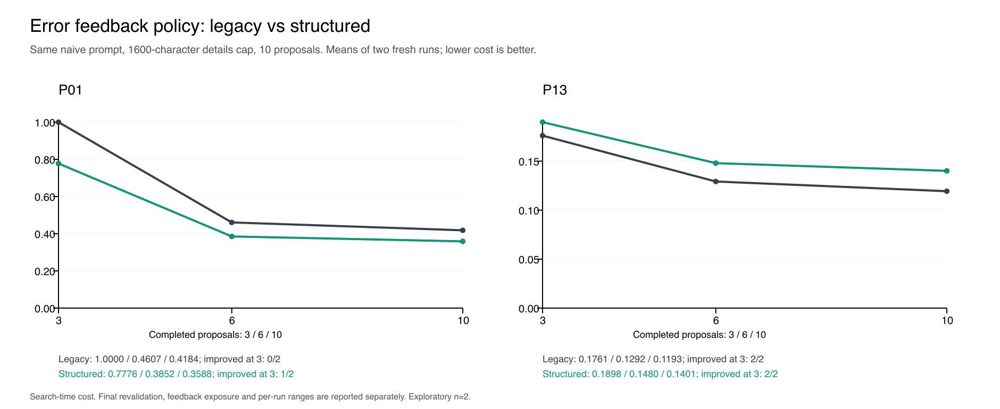

# 오류 피드백 구조화: P01·P13 A/B 결과

독립변수는 실패한 Lean 컴파일의 오류 선택·구조화 정책이다. L은 기존 피드백, S는 첫 오류와 목표·주변 가정을 구조화한 피드백이다. 두 조건 모두 details 상한은 1,600자이며 같은 naive 프롬프트를 사용했다. JSON 표기만의 효과를 분리한 실험은 아니다.

문제별·조건별 새 solver 2개, 실행당 후보 10개로 총 8개 실행·80개 후보를 평가했다. 최대 2개 solver를 동시 실행했다. 첫 요청은 같은 문제의 네 실행에서 바이트 단위로 동일했다. 추가 검증·라이브러리 검색·전략 지침을 주지 않았고 성공 피드백은 기존과 같다.

주 관측값은 3회차에 원본보다 낮은 비용을 찾은 실행 수다. 비용은 `0.5 × (tokens/원본tokens + rawHB/원본rawHB)`이며 낮을수록 좋다. 모든 실행은 처음부터 10회 예산을 알고 있었고 3·6회는 중간 관측이다.

| 문제 | 조건 | 3회차 개선 실행 | 초반 유효 후보 평균/3 | 3회 비용 | 6회 비용 | 10회 비용 | 최종 검증 |
|---|---|---:|---:|---:|---:|---:|---:|
| P01 | L | 0/2 | 1.50 | 1.000000 | 0.460664 | 0.418380 | 2/2 |
| P01 | S | 1/2 | 1.50 | 0.777568 | 0.385224 | 0.358837 | 2/2 |
| P13 | L | 2/2 | 2.50 | 0.176079 | 0.129222 | 0.119328 | 2/2 |
| P13 | S | 2/2 | 2.00 | 0.189825 | 0.147987 | 0.140107 | 2/2 |

이번 표본에서 구조화 조건의 10회차 평균 비용 변화는 기존 대비 P01 -14.23%, P13 +17.41%였다. P01의 3회차 개선은 0/2에서 1/2로 늘었지만 초반 유효 후보 수는 두 조건 모두 평균 1.5/3으로 같았다. 구조화 피드백의 일관된 성능 향상을 확인한 결과는 아니다.

P01의 3회차 정체 실행들은 모두 그때까지 유효한 후보를 만들었다. 예를 들어 S-r1의 3회차는 33토큰이지만 12,283,267 raw HB여서 원본보다 종합 비용이 높았다. 오류 전달 개선만으로 높은 검증 비용까지 해결되지는 않았다. P13의 L 두 실행은 3회차 전에 오류 피드백을 받지 않았고 S 두 실행은 각각 한 번 받았다. 첫 요청은 같아도 첫 응답부터 탐색 경로가 달랐으므로 이 초기 차이를 피드백의 인과효과로 단정할 수 없다.

| 실행 | 첫 유효 후보 | 첫 비용 개선 | 초반 유효/3 | 3회차 전 오류 노출 | 3회 비용 | 6회 비용 | 10회 비용 | 최종 검증 |
|---|---:|---:|---:|---:|---:|---:|---:|---|
| [P01-L-r1](selected/P01-L-r1.lean) | 2 | 4 | 1/3 | 1 | 1.000000 | 0.532631 | 0.453730 | 통과 |
| [P01-L-r2](selected/P01-L-r2.lean) | 2 | 5 | 2/3 | 1 | 1.000000 | 0.388697 | 0.383030 | 통과 |
| [P01-S-r1](selected/P01-S-r1.lean) | 3 | 4 | 1/3 | 2 | 1.000000 | 0.386025 | 0.359247 | 통과 |
| [P01-S-r2](selected/P01-S-r2.lean) | 2 | 2 | 2/3 | 1 | 0.555137 | 0.384422 | 0.358428 | 통과 |
| [P13-L-r1](selected/P13-L-r1.lean) | 1 | 1 | 3/3 | 0 | 0.173042 | 0.146133 | 0.136811 | 통과 |
| [P13-L-r2](selected/P13-L-r2.lean) | 1 | 1 | 2/3 | 0 | 0.179115 | 0.112311 | 0.101846 | 통과 |
| [P13-S-r1](selected/P13-S-r1.lean) | 2 | 2 | 2/3 | 1 | 0.190582 | 0.165418 | 0.158783 | 통과 |
| [P13-S-r2](selected/P13-S-r2.lean) | 2 | 2 | 2/3 | 1 | 0.189069 | 0.130555 | 0.121431 | 통과 |

오류 피드백을 받은 적 없는 실행에서는 해당 시점까지 독립변수에 실제 노출되지 않았다. 오류가 발생한 후의 다음 후보 성공률은 서로 다른 탐색 경로에서 생긴 관측이므로 오류별 인과효과로 해석하지 않는다. 처음 3회에 개선하지 못한 실행도 유효한 증명은 만들었을 수 있다.

P01-L-r1과 P13-S-r1은 계정 사용량 제한으로 중단됐다가 사용자의 재개 지시에 따라 같은 solver 문맥에서 이어갔다. 진행 중인 검증은 없었고 완료 후보를 재시도하거나 예산을 추가하지 않았다. 이 운영 중단은 결과 해석의 한계로 남는다.

| 문제 | 조건 | 3회 비용 범위 | 6회 비용 범위 | 10회 비용 범위 |
|---|---|---|---|---|
| P01 | L | 1.000000–1.000000 | 0.388697–0.532631 | 0.383030–0.453730 |
| P01 | S | 0.555137–1.000000 | 0.384422–0.386025 | 0.358428–0.359247 |
| P13 | L | 0.173042–0.179115 | 0.112311–0.146133 | 0.101846–0.136811 |
| P13 | S | 0.189069–0.190582 | 0.130555–0.165418 | 0.121431–0.158783 |

[동일한 과거 로그의 형식 비교](offline-formatter-check.json)는 정보 보존을 확인하는 검사이며 solver 성능 자료가 아니다. 현재 후보는 일반 컴파일 1회와 측정 3회의 중앙값으로 평가하고 최종 선택본도 별도 재검증했다. Lean·문맥·공통 기준값·worker·420초 invocation 제한·예산·선택 규칙은 조건 간 동일하다.

조건당 두 번의 탐색은 통계적 우위를 입증하지 않는다. 두 문제 모두 개발에 사용한 문제다. 정확한 모델 ID·sampling seed·숨겨진 문맥·내부 호출 수·요금은 관측하거나 고정하지 못했다. 라이브러리는 정책상 읽기 전용 공유이며 OS 격리는 없다. 기록 replay는 모델 재생성이 아니다.

최종 검증 8/8, 기록 감사 통과. 운영 사건 1건. 사건의 상세 내용은 전체 결과 JSON에 보존했다. 원본 로그는 아래 로컬 원문 경로에 있다.

[전체 결과](results.json) · [실행 프로토콜](execution-protocol.json) · [전후 런타임 해시](runtime-checks.json) · [사전 설계](design.frozen.json) · [실제 배정 순서](dispatch.jsonl)

원문: `/Users/zzu0203/projects/01_가짜연구소/LeanAgent-LeanRefactorArena/runs/first-harness-jwkweon/feedback-ablation-20261025`
