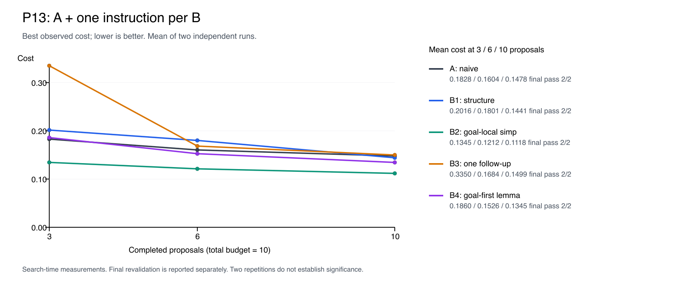

# P13 프롬프트 개별 효과 실험 결과

이번 표본에서 10회차 평균 비용이 가장 낮은 조건은 **B2 (목표 중심 simplification)**였다. 평균 0.111758로 A의 0.147828보다 24.40% 낮았다. 조건당 두 번의 탐색 결과이므로 후속 검증 후보를 고르는 근거로 해석한다.

A와 A에 지침 하나씩 추가한 B1~B4를 각각 새 solver 두 개로 실행했다. 동시 solver 상한은 2개이며 10개 실행, 후보 100개를 완료했다. 모든 실행의 예산은 처음부터 10회이고 3·6·10회차의 누적 최선을 관측했다.

로컬 비용은 `0.5 × (tokens / 1769 + raw_heartbeats / 115674908)`이며 낮을수록 좋다. 아래는 탐색 중 관측값이다. 최종 선택본은 별도 검증했다.

| 조건 | 추가 지침 | 3회 평균 | 6회 평균 | 10회 평균 | 10회 B−A | 최종 검증 |
|---|---|---:|---:|---:|---:|---:|
| A | 기존 naive | 0.182837 | 0.160361 | 0.147828 | +0.000000 | 2/2 |
| B1 | 증명 구조 대안 | 0.201585 | 0.180073 | 0.144100 | -0.003729 | 2/2 |
| B2 | 목표 중심 simplification | 0.134525 | 0.121200 | 0.111758 | -0.036071 | 2/2 |
| B3 | 구조 변경 후 1회 후속 개선 | 0.335019 | 0.168382 | 0.149909 | +0.002080 | 2/2 |
| B4 | 목표에서 lemma 역방향 적용 | 0.186020 | 0.152586 | 0.134457 | -0.013372 | 2/2 |

B−A가 음수이면 해당 회차에서 B의 평균 비용이 더 낮다. 반복이 두 번뿐이므로 통계적 우위나 다른 문제로의 일반화를 주장할 수 없다. 누적 최선은 구조상 나빠지지 않으므로 3→10회 개선 자체가 프롬프트 효과의 증거는 아니다.

한 조건에 추가한 지침이 하나라는 뜻이지, solver의 실제 코드 변경이 한 종류로 제한된다는 뜻은 아니다. 예를 들어 B2-r1의 선택본은 `Fin 4 → Set.Icc B T`로 네 값의 상태를 표현했다. 따라서 조건 간 차이는 지침을 받은 탐색의 결과이며 특정 tactic 하나의 순수 실행 비용 차이가 아니다.

| 실행 | 3회 비용 | 6회 비용 | 10회 비용 | 유효/10 | 선택 토큰 | 선택 raw HB | 최종 검증 |
|---|---:|---:|---:|---:|---:|---:|---|
| [P13-A-r1](selected/P13-A-r1.lean) | 0.162290 | 0.151928 | 0.146323 | 9/10 | 452 | 4,295,585 | 통과 |
| [P13-A-r2](selected/P13-A-r2.lean) | 0.203385 | 0.168794 | 0.149334 | 8/10 | 423 | 6,888,338 | 통과 |
| [P13-B1-r1](selected/P13-B1-r1.lean) | 0.188924 | 0.164447 | 0.114235 | 10/10 | 360 | 2,887,802 | 통과 |
| [P13-B1-r2](selected/P13-B1-r2.lean) | 0.214247 | 0.195700 | 0.173965 | 7/10 | 528 | 5,720,822 | 통과 |
| [P13-B2-r1](selected/P13-B2-r1.lean) | 0.120765 | 0.108081 | 0.099812 | 7/10 | 311 | 2,755,270 | 통과 |
| [P13-B2-r2](selected/P13-B2-r2.lean) | 0.148285 | 0.134319 | 0.123703 | 9/10 | 389 | 3,182,031 | 통과 |
| [P13-B3-r1](selected/P13-B3-r1.lean) | 0.513856 | 0.182358 | 0.154127 | 7/10 | 477 | 4,466,174 | 통과 |
| [P13-B3-r2](selected/P13-B3-r2.lean) | 0.156181 | 0.154405 | 0.145691 | 9/10 | 445 | 4,606,947 | 통과 |
| [P13-B4-r1](selected/P13-B4-r1.lean) | 0.170355 | 0.151994 | 0.146043 | 7/10 | 424 | 6,061,587 | 통과 |
| [P13-B4-r2](selected/P13-B4-r2.lean) | 0.201684 | 0.153178 | 0.122871 | 7/10 | 351 | 5,474,294 | 통과 |

| 조건 | 3회 범위 | 6회 범위 | 10회 범위 | 후보 오류 종류·횟수 |
|---|---|---|---|---|
| A | 0.162290–0.203385 | 0.151928–0.168794 | 0.146323–0.149334 | {"compile": 3} |
| B1 | 0.188924–0.214247 | 0.164447–0.195700 | 0.114235–0.173965 | {"compile": 3} |
| B2 | 0.120765–0.148285 | 0.108081–0.134319 | 0.099812–0.123703 | {"compile": 4} |
| B3 | 0.156181–0.513856 | 0.154405–0.182358 | 0.145691–0.154127 | {"compile": 4} |
| B4 | 0.170355–0.201684 | 0.151994–0.153178 | 0.122871–0.146043 | {"compile": 6} |

Lean 4.26.0과 고정 Mathlib, 동일 worker, 원본 기준값을 사용했다. 후보를 일반 컴파일로 먼저 확인하고 통과한 후보는 추가 측정 3회의 중앙값을 사용했다. 최종 선택본도 일반 컴파일 1회와 측정 3회로 별도 재검증했다. 각 invocation의 제한은 420초이며 무효·시간 초과 후보도 예산에 포함했다. 실패에 따라 재시도하거나 조건을 바꾸지 않았다.

전체 10개 기록 replay와 파일 해시 검사를 통과했다. 공유 런타임 95,212개 파일의 전후 SHA256도 일치했다. 이 검사는 기록의 일관성과 바이트 불변성을 확인하며, OS 수준 격리나 모델 응답의 동일성을 보장하지 않는다.

초기 A-r1·B3-r1에서 큰 시계 간격이 관측되었고 원인은 확정하지 못했다. 따라서 실행 경과 시간을 모델·증명 계산 시간으로 해석하지 않는다. 이후 시계 관측 기록을 보존했다. 정확한 모델 ID·샘플링 seed·숨겨진 문맥·내부 호출 수·요금은 통제하거나 관측하지 못했다.

기존 제출본의 과거 관측값은 259 tokens / 2,931,231 raw HB이며 공통 분모에서 비용 0.085875다. 이번에 재측정한 실험군은 아니며 solver에 제공하지 않았다.

[감사된 전체 결과](results.json), [export 해시](export-provenance.json), [사전 설계](../design.json), [실행 프로토콜](execution-protocol.json), [실제 배정 순서](dispatch.jsonl), [각 프롬프트](../prompts/). 원문 실행 기록: `/Users/zzu0203/projects/01_가짜연구소/LeanAgent-LeanRefactorArena/runs/first-harness-jwkweon/p13-prompt-ablation-20261024`.
